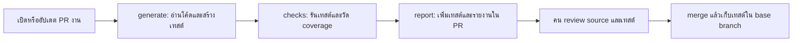

# Automated Quality Gate · GitHub Action

GitHub Action สำหรับใช้ AI ช่วย review โค้ด สร้าง unit tests รันตรวจคุณภาพ และเก็บเทสต์ไว้ใน Pull Request เพื่อให้ตรวจได้ก่อน merge

รองรับ **JavaScript/Jest** และ **AngularJS 1.x** พร้อมการวัด coverage จากการรันจริง ใช้ Gemini API หรือบริการแบบ OpenAI-compatible Chat Completions ตามค่าที่ผู้ใช้กำหนด

## สารบัญ

- [ภาพรวมระบบ](#ภาพรวมระบบ)
- [ความสามารถ](#ความสามารถ)
- [เริ่มใช้งาน](#เริ่มใช้งาน)
- [Workflow และสิทธิ์](#workflow-และสิทธิ์)
- [การตั้งค่า AI](#การตั้งค่า-ai)
- [Action inputs](#action-inputs)
- [ไฟล์เทสต์ใน PR](#ไฟล์เทสต์ใน-pr)
- [Coverage และผลตรวจ](#coverage-และผลตรวจ)
- [รันเทสต์ที่บันทึกแล้วซ้ำ](#รันเทสต์ที่บันทึกแล้วซ้ำ)
- [ข้อจำกัดและการแก้ปัญหา](#ข้อจำกัดและการแก้ปัญหา)
- [สำหรับผู้พัฒนา Action](#สำหรับผู้พัฒนา-action)

## ภาพรวมระบบ

| Repository | หน้าที่ |
| --- | --- |
| [**Web UI**](https://github.com/ginnn888/Automated-Quality-Gate-with-AI-UI) | เลือก repo ตั้งค่า AI บันทึก keys และสร้าง PR ติดตั้ง |
| **Action — repository นี้** | อ่านโค้ด สร้างและรันเทสต์ วัด coverage บันทึกเทสต์เข้า PR และรายงานผล |



## ความสามารถ

- ใช้ AI วิเคราะห์โค้ดและสร้างเทสต์สำหรับโปรเจกต์ที่รองรับ
- รับชื่อโมเดลจากผู้ใช้โดยไม่มีรายชื่อโมเดลตายตัว
- รัน Jest สำหรับ JavaScript หรือ Node Test Runner + jsdom สำหรับ AngularJS
- วัด coverage และเทียบเกณฑ์รวม/เฉพาะไฟล์จาก `config_cov.json`
- ตรวจ dependencies ด้วย npm audit และรองรับ SonarCloud แบบตัวเลือกสำหรับ JavaScript
- เก็บไฟล์เทสต์ใน PR งานเดิม แม้เทสต์จะรันไม่ผ่าน
- แยกรายงาน **Test Results**, **Security Audit** และ **AI Code Review** พร้อมอัปเดตคอมเมนต์เดิม
- ไม่ merge อัตโนมัติ ไม่ force-push และไม่เขียนเทสต์ลง default branch โดยตรง

> การติดตั้ง Action สำเร็จไม่ได้แปลว่าผลตรวจผ่าน การบล็อก merge ต้องตั้ง branch rules ของ repository เพิ่ม

## เริ่มใช้งาน

### วิธีแนะนำ: ติดตั้งผ่าน Web UI

1. เปิด [โปรเจกต์ Web UI](https://github.com/ginnn888/Automated-Quality-Gate-with-AI-UI) และตั้งค่าเว็บตาม README ของส่วนนั้น
2. Login ด้วย GitHub และเลือก repo งาน
3. เลือก JavaScript/Jest หรือ AngularJS ตั้งค่า AI และ coverage
4. บันทึก API key ลง Repository Secrets
5. กด **Install / อัปเดต** เว็บจะตรวจและรวมไฟล์ที่จำเป็นใน PR เดียว
6. ตรวจและ merge PR ติดตั้ง แล้วเปิด PR งานเพื่อเริ่มตรวจโค้ด

เว็บเก็บ dependencies และ test config เดิมที่ใช้ได้ เพิ่มไฟล์ที่ขาดในกรณีที่รองรับ และแจ้งเหตุผลหากจัดการอัตโนมัติไม่ได้ ไม่ต้อง merge PR เตรียมโปรเจกต์แยกก่อน

### สำหรับผู้ที่เตรียม workflow เอง

ดูตัวอย่างฉบับเต็มที่ตรงกับ workflow ของเว็บ:

- [JavaScript/Jest workflow](docs/examples/javascript.yml)
- [AngularJS workflow](docs/examples/angularjs.yml)

คัดลอกตัวอย่างที่เลือกไปเป็น `.github/workflows/quality-gate.yml` และเตรียม `config_cov.json` ที่ root เช่น:

```json
{
  "global": 80,
  "files": {
    "src/math.js": 90
  }
}
```

ตัวอย่าง workflow ตรึงกับ commit ที่มีความสามารถชุดนี้ ไม่ใช่ tag รุ่นเก่า หากเปลี่ยน Action version ให้เปลี่ยน **ทุก job เป็น commit เดียวกัน** และตรวจว่า commit นั้นมี `dist/index.js` ที่ build แล้ว

**สิ่งที่โปรเจกต์ต้องมี:**

| ชนิด | สิ่งที่ต้องเตรียม |
| --- | --- |
| JavaScript/Jest | npm package/lockfile ที่ตรงกัน, Jest และ config ที่รันเทสต์ใน `Test/quality-gate/` และวัด coverage ของ `src/` ได้ |
| AngularJS | package/lockfile ของแอปที่ตรงกัน, dependency `angular` และ source ใน `src/` |
| AngularJS ที่ต้องการรันเทสต์ที่บันทึกแล้วในเครื่อง | ชุดเครื่องมือ `quality-gate/` ซึ่ง Web UI เตรียมให้ใน PR ติดตั้ง |

หากติดตั้งเอง Action ใช้ runtime ของตัวเองสำหรับ job checks ได้ แต่การเก็บเพียง `generated.test.cjs` โดยไม่มีชุดเครื่องมือยังไม่เพียงพอสำหรับรันเทสต์ AngularJS ซ้ำในเครื่อง จึงแนะนำให้ติดตั้งผ่านเว็บ

## Workflow และสิทธิ์

ใช้สาม jobs เพื่อแยกโค้ดที่ไม่น่าเชื่อถือออกจาก keys และสิทธิ์เขียน:

| Job | ทำอะไร | สิทธิ์/ข้อมูลที่ใช้ |
| --- | --- | --- |
| **generate** | อ่าน source ผ่าน GitHub API เรียก AI และสร้าง artifact | Contents read, Pull requests read และ AI key; ไม่ checkout หรือ execute โค้ด PR |
| **checks** | Checkout PR head ที่ระบุ ติดตั้ง dependencies และรันเทสต์/coverage | Contents read; ไม่มี AI key หรือสิทธิ์เขียน repo |
| **report** | อ่าน artifacts เพิ่มเทสต์เข้า PR และโพสต์รายงาน/check | Contents write, Pull requests write และ Checks write; ไม่ checkout หรือ execute โค้ด PR |

Workflow ที่เว็บสร้างใช้ `pull_request_target` โดยแยก jobs ตามตาราง ห้ามย้ายการรันโค้ดหรือเทสต์จาก PR ไปไว้ใน job generate/report ที่มี secrets หรือสิทธิ์เขียน

Dependency installation ใช้ `npm ci --ignore-scripts` ใน job checks หากเปิด SonarCloud สำหรับ JavaScript เฉพาะขั้น scan จะรับ Sonar token ตาม workflow

Artifacts ที่ใช้:

| Artifact | เนื้อหา |
| --- | --- |
| `aq-generated-tests` | เทสต์และ metadata จากขั้นสร้าง ผูกกับ PR head ที่ตรวจ |
| `quality-gate-results` | ผลเทสต์ สถานะการตรวจ และไฟล์ coverage |

Repository/organization policies หรือ branch protection อาจไม่อนุญาตให้บันทึกเทสต์หรือสร้าง check ระบบจะแจ้งข้อผิดพลาด ไม่ข้ามข้อจำกัดนั้น

## การตั้งค่า AI

### Gemini API

บันทึก `GEMINI_API_KEY` ใน Repository Secrets แล้วส่ง input ให้ขั้น generate:

```yaml
with:
  project_type: javascript
  phase: generate
  gemini_model: gemini-3.1-flash-lite
  gemini_api_key: ${{ secrets.GEMINI_API_KEY }}
  github_token: ${{ github.token }}
  ai_timeout_seconds: '90'
```

ชื่อโมเดลข้างต้นเป็นค่าเริ่มต้นในโค้ด ไม่ใช่การยืนยันว่าบัญชีทุกบัญชีจะเรียกได้ ผู้ใช้เปลี่ยนชื่อโมเดลได้เอง

### OpenAI-compatible Chat Completions

บันทึก `AI_API_KEY` ของบริการที่เลือก แล้วใช้รูปแบบ:

```yaml
with:
  project_type: javascript
  phase: generate
  ai_provider: openai-compatible
  ai_api_url: https://your-provider.example/v1/chat/completions
  ai_model: your-model-id
  ai_api_key: ${{ secrets.AI_API_KEY }}
  github_token: ${{ github.token }}
  ai_timeout_seconds: '90'
```

สอง snippet นี้เป็น **inputs ของขั้น generate** ไม่ใช่ workflow ครบชุด ให้ใช้ร่วมกับตัวอย่างสาม jobs ด้านบน ขั้น checks/report ไม่ต้องรับ AI key

บริการต้องรับ `model` และ `messages` พร้อมส่งข้อความกลับผ่าน `choices[0].message.content` รูปแบบ API อื่น เช่น Anthropic Messages หรือ OpenAI Responses ยังใช้โดยตรงไม่ได้

HTTPS URL ต้องเป็นปลายทางสาธารณะ ไม่มี credentials/query/fragment และไม่ redirect ระบบปฏิเสธ IP ภายในและไม่คัดลอก error body ของผู้ให้บริการมาพิมพ์เป็นข้อผิดพลาด

หาก key ผิด ไม่พบโมเดล โควตาหมด หมดเวลารอ หรือคำตอบนำไปใช้ไม่ได้ ระบบรายงานว่าไม่สำเร็จ ไม่มีการเปลี่ยนผู้ให้บริการหรือโมเดลเอง โค้ดจะถูกส่งให้ปลายทางที่ผู้ใช้เลือกและใช้โควตาของบัญชีนั้น

## Action inputs

| Input | ค่าเริ่มต้น | หน้าที่ |
| --- | --- | --- |
| `project_type` | `auto` | `javascript` หรือ `angularjs`; workflow แบบแยก jobs ควรระบุให้ชัด |
| `phase` | `all` | `generate`, `checks`, `report`; `all` ใช้กับเส้นทาง legacy ไม่ใช่ flow ติดตั้งใหม่ |
| `test_source` | `generated` | AngularJS ใช้เทสต์ที่ Action สร้าง; `existing` เป็นโหมดเทสต์เดิม |
| `ai_provider` | `gemini` | เลือกรูปแบบ API: `gemini` หรือ `openai-compatible` |
| `ai_model` | ไม่มี | ชื่อโมเดลที่ผู้ใช้กำหนด มีลำดับเหนือ `gemini_model` |
| `ai_api_url` | ไม่มี | HTTPS Chat Completions endpoint แบบเต็ม |
| `ai_api_key` | ไม่มี | Key ของบริการ OpenAI-compatible ส่งผ่าน secret ใน generate |
| `gemini_model` | `gemini-3.1-flash-lite` | ชื่อโมเดลสำหรับ Gemini |
| `gemini_api_key` | ไม่มี | Key ของ Gemini ส่งผ่าน secret ใน generate |
| `github_token` | `${{ github.token }}` | ใช้ GitHub API ตามสิทธิ์ของแต่ละ job |
| `ai_timeout_seconds` | `60` | เวลารอต่อคำขอ 10–180 วินาที; เว็บตั้งเริ่มต้น 90 วินาที |
| `install_status` | `success` | ส่งผล dependency installation ให้ขั้น checks |
| `persist_tests` | `false` | ตั้ง `true` ใน report เพื่อบันทึกเทสต์กลับ PR |
| `report_only` | `false` | AngularJS: หากเป็น `true` อาจรายงานผลไม่ผ่านโดยไม่ทำให้ job ล้มเหลว; workflow ใหม่ใช้ `false` |
| `sonar_token` | ไม่มี | Token สำหรับ SonarCloud ของ JavaScript |

ค่า `persist_tests` ต้องเปิดผ่าน workflow ด้วย การใส่ key เพียงอย่างเดียวไม่ได้เปิดการเขียนเทสต์

## ไฟล์เทสต์ใน PR

| โปรเจกต์ | ตำแหน่ง |
| --- | --- |
| JavaScript/Jest | `Test/quality-gate/<source-path-hash>.test.js` |
| AngularJS | `quality-gate/generated.test.cjs` |

หลังขั้น checks ระบบจะเพิ่มไฟล์เทสต์เข้า **branch ของ PR งานเดียวกัน** ผู้ตรวจเห็นทั้ง source และเทสต์ใน Files changed ก่อน merge เมื่อ merge เทสต์จึงเข้า base branch พร้อมโค้ด

- เทสต์ที่ล้มเหลวก็เก็บให้ review ได้ ไม่ปรับ assertion เพื่อให้ผ่าน
- ไม่เขียนทับไฟล์ที่ไม่มีเครื่องหมายว่าเป็นเทสต์ที่ระบบสร้าง
- พื้นที่เทสต์ที่ระบบสร้างจะถูก Action จัดการ เทสต์ที่ผู้ใช้ต้องการดูแลเองควรอยู่นอกพื้นที่นี้
- หาก PR head เปลี่ยนระหว่างตรวจ ให้รันใหม่กับ commit ล่าสุด ไม่ force-push ทับงานใหม่
- เทสต์ที่เหมือนเดิมไม่สร้าง commit เพิ่ม และ workflow ข้าม event จาก GitHub Actions bot เพื่อป้องกันการวนซ้ำ
- หลังเพิ่มเทสต์ ระบบสร้าง check ชื่อ **Quality Gate** บน commit ใหม่ โดยอ้างอิง source ที่ตรวจและผลรอบนั้น

ต้องตั้ง branch rules ให้ใช้ check **Quality Gate** หากต้องการบล็อก merge เมื่อไม่ผ่าน ไม่ควรถือว่าการมีคอมเมนต์หรือมี commit เทสต์หมายถึงผ่านแล้ว

## Coverage และผลตรวจ

เกณฑ์ใน `config_cov.json` ใช้ **statements coverage**:

- `global` — เกณฑ์รวมของโปรเจกต์
- `files` — เกณฑ์เฉพาะไฟล์ที่กำหนด

รายงาน coverage มีข้อมูล statements, branches, functions และ lines AngularJS instrument source ก่อนรันใน jsdom และนับไฟล์ที่ไม่ได้ execute ไว้ที่ 0% ด้วย

**ผลเทสต์และ coverage แยกกัน:** เทสต์ผ่านแต่ coverage ต่ำยังไม่ผ่าน; coverage ถึงเกณฑ์แต่เทสต์ล้มเหลวยังไม่ผ่าน หากไม่มีผลตรวจที่ยืนยันได้จะรายงานไม่พร้อมใช้งาน ไม่แสดงเป็นผ่าน

| ตำแหน่ง | ใช้ดูอะไร |
| --- | --- |
| PR comments | Test Results, Security Audit และ AI Code Review |
| Check `Quality Gate` | ผลตรวจบน head ที่มีเทสต์บันทึกแล้ว |
| Workflow logs | สาเหตุข้อผิดพลาดและรายละเอียดการรัน |
| Artifacts | เทสต์ที่สร้าง ผลตรวจ และรายงาน coverage |

AngularJS เก็บไฟล์ coverage ใน `coverage/quality-gate/` ได้แก่ `coverage-summary.json`, `lcov.info`, `index.html` และ `result.json` ส่วน JavaScript ใช้ output ของ Jest ใน `coverage/`

npm audit ตรวจ dependencies แยกจากเทสต์ และใช้ High/Critical เป็นเกณฑ์ความปลอดภัย SonarCloud เป็นตัวเลือกเฉพาะ JavaScript; การวิเคราะห์อัตโนมัติของ SonarCloud แยกจาก CI scan ใน workflow นี้

## รันเทสต์ที่บันทึกแล้วซ้ำ

### JavaScript/Jest

```powershell
npm ci
npx jest --coverage
```

Jest config เดิมต้องรวม `Test/quality-gate/` หากไม่รันเทสต์ที่สร้างทั้งหมด ระบบจะแจ้งว่า config ไม่ครอบคลุม

### AngularJS

หลัง merge PR ติดตั้งที่มีชุดเครื่องมือ และมีเทสต์ที่บันทึกแล้ว:

```powershell
npm ci
npm ci --prefix quality-gate
node quality-gate/run.cjs
```

ชุดเครื่องมืออยู่แยกจาก dependencies และ scripts ของแอป ประกอบด้วย runner, harness, assertion helper และ package/lockfile ที่ตรึง dependencies สำหรับเทสต์

## ข้อจำกัดและการแก้ปัญหา

| อาการ/ข้อจำกัด | สิ่งที่ควรตรวจ |
| --- | --- |
| โมเดลเรียกไม่ได้ | Key, URL, ชื่อโมเดล, สิทธิ์บัญชี, quota และรูปแบบ API |
| `npm ci` ไม่ผ่าน | Root package/lockfile ต้องตรงกัน; install scripts ถูกปิดใน checks |
| ไม่เห็นเทสต์ใน Files changed | ต้องมี `persist_tests: true`, สิทธิ์ Contents/Checks write และ PR head ที่ยังตรงกัน |
| Branch เปลี่ยนระหว่างรัน | รัน workflow ใหม่กับ commit ล่าสุด |
| Coverage ไม่พร้อมใช้งาน | ดู logs, config และว่าเทสต์ได้ execute source จริงหรือไม่ |
| Jest ไม่พบเทสต์ที่สร้าง | ปรับ test roots/testMatch ให้รวม `Test/quality-gate/` |
| Job สีเขียวแต่รายงานไม่ผ่าน | ตรวจว่าใช้ legacy `report_only: true` หรือไม่ และอ่านผลตรวจจริง |

ขอบเขตหลักคือ JavaScript CommonJS + npm ที่ root และ AngularJS 1.x ที่มี source ใน `src/` โปรเจกต์ TypeScript, JSX, ESM, workspaces, monorepo หรือ bootstrap ซับซ้อนอาจต้องตั้งค่าเฉพาะ Workflow ที่เว็บสร้างข้าม fork และ Dependabot และไม่บันทึกเทสต์ไปยัง fork

รุ่นใหม่ไม่ได้เปลี่ยน workflow ของ repository ที่ติดตั้งแล้วโดยอัตโนมัติ ต้องสร้างและ merge PR อัปเดต workflow ก่อน

## สำหรับผู้พัฒนา Action

### โครงสร้าง

```text
action.yml                  Inputs และ entry point ที่ GitHub ใช้
generate-tests.js           CLI/build entry point
lib/gate.js                 ควบคุม phase, AI และการรายงาน
lib/ai/                     AI client และการจัดการข้อผิดพลาด
lib/javascript-phases.js    Generate/checks สำหรับ JavaScript
lib/angularjs/              AngularJS generation, harness และ coverage tooling
lib/persist-tests.js        ตรวจ PR head และบันทึกเทสต์ผ่าน GitHub API
lib/reporting/              จัดรูปแบบและอัปเดตคอมเมนต์
lib/prompts/                Prompt สำหรับสร้างเทสต์
tests/                      Regression, AI และ pipeline tests
tests/fixtures/             โปรเจกต์ตัวอย่างสำหรับทดสอบระบบ
dist/index.js               Bundle ที่ GitHub รันจริง
docs/                       ตัวอย่าง workflow และรายละเอียดเพิ่มเติม
src/                        โค้ดตัวอย่างเดิม ไม่ใช่ implementation หลักของ Action
```

### ติดตั้งและตรวจงาน

ใช้ Node.js 22 ขึ้นไปสำหรับพัฒนา และ npm:

```powershell
npm ci
npm run test:setup
npm run test:angularjs
npm run test:ai
npm run test:pipeline
npm run build
```

| คำสั่ง | ตรวจอะไร |
| --- | --- |
| `test:setup` | เตรียม dependencies ของ tooling และ AngularJS fixture |
| `test:angularjs` | Regression ของ AngularJS และการรายงาน |
| `test:ai` | AI client, transport และ failure handling |
| `test:pipeline` | Jest/AngularJS ที่รันจริง, coverage และการเขียน GitHub แบบ mock |
| `build` | สร้าง `dist/index.js` ด้วย ncc |

`npm test` เป็นคำสั่ง Jest ของตัวอย่าง legacy ไม่ใช่ชุดทดสอบครบของ Action ให้ใช้คำสั่งในตารางสำหรับตรวจ implementation

### เผยแพร่รุ่นใหม่

1. รันชุดทดสอบและ `npm run build`
2. Commit source พร้อม `dist/index.js` ห้ามแก้ bundle โดยตรง
3. เผยแพร่ commit ไป GitHub
4. อัปเดต `engineRef` ใน Web UI และ workflow ตัวอย่างให้ตรงกัน
5. หากเปลี่ยน AngularJS tooling ให้อัปเดต snapshot `src/lib/angularjs-toolkit.json` ของเว็บด้วย
6. ทดลองบน repository แยกด้วย GitHub App และ AI key จริง ก่อนให้ผู้ใช้ merge PR อัปเดต

Tests ใช้ทั้ง mocks และ fixture ที่รันจริง แต่ไม่ได้ยืนยันว่า AI ทุกโมเดลหรือ repository ทุกแบบจะทำงานสำเร็จ รายงาน fixture ไม่ใช่ผลตรวจ repo ผู้ใช้

### เอกสารเพิ่มเติม

- [รายละเอียดการเก็บเทสต์ การแยก jobs และ coverage](docs/reviewable-tests.md)
- [การตั้งค่า AI และขอบเขต API](docs/ai-providers.md)
- [โครงสร้าง Action](docs/structure.md)
- [บันทึก workflow AngularJS รุ่นก่อน](docs/angularjs.md)
